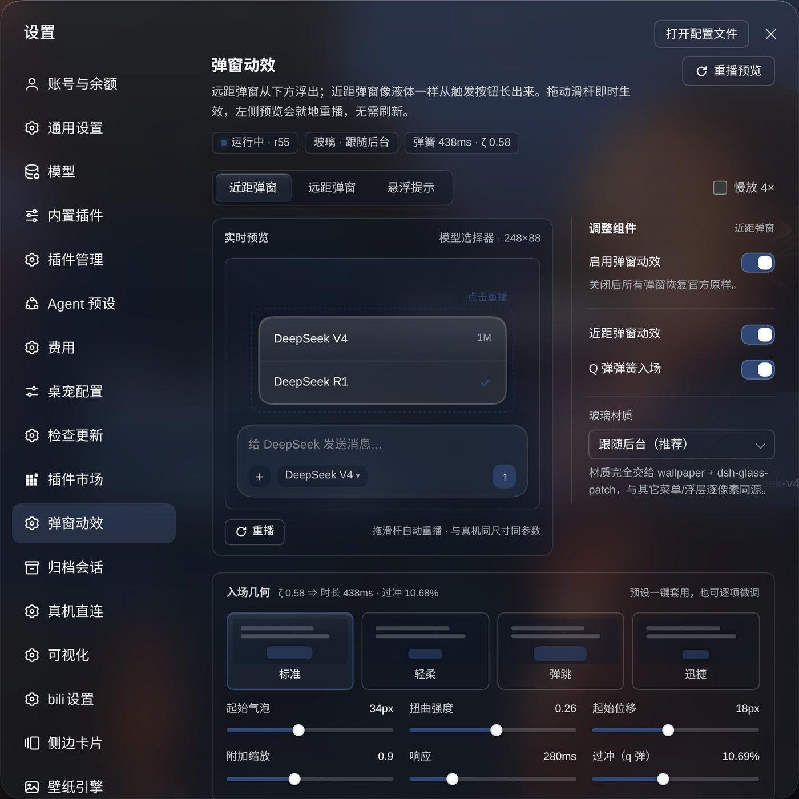
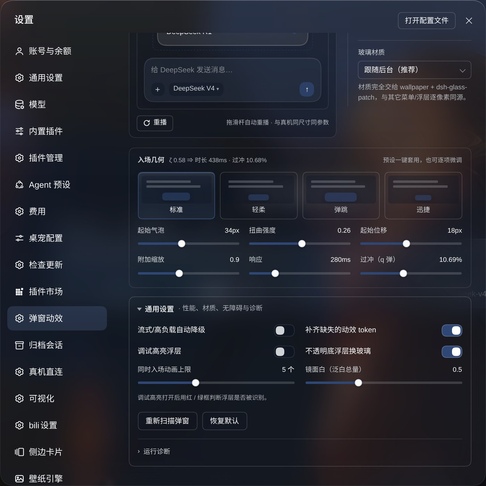
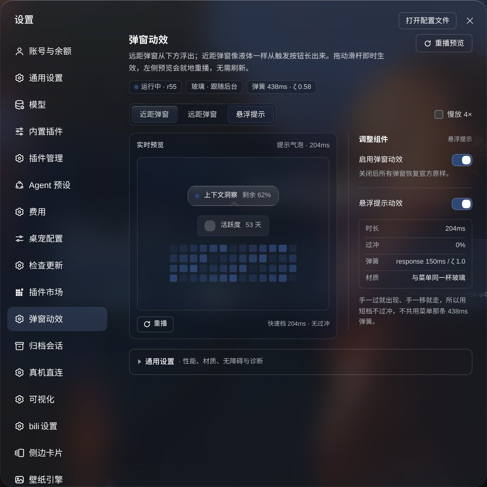

# dsh-motion

> DSH（DeepSeek Harness）Web UI 的弹窗 / 浮层动效：近距弹窗像液体一样从触发按钮长出（clip 形变 + Q 弹弹簧 + 宿主玻璃材质），远距弹窗从下方浮出，悬浮提示走 204ms 快速档；另外还有会话预览卡 / 上下文洞察气泡的连贯切换、图片放大 FLIP，以及一个能实时预览的设置页。
>
> *Popup & overlay motion for DeepSeek Harness: iOS-style spring clip-morph entrances for nearby popups, fade-up far dialogs, coherent hover-bubble handoff, image-zoom FLIP, and a live-preview settings page. Client-only — no official files are modified.*

[GitHub](https://github.com/picklerick422/dsh-motion) · [Releases](https://github.com/picklerick422/dsh-motion/releases) · [Issues](https://github.com/picklerick422/dsh-motion/issues)



## 它是什么

DSH 的弹窗默认是**瞬时出现**的。这个插件把「出现 / 消失」补成有物理感的动效，并让浮层材质与宿主保持一致：

- **近距浮层**（菜单、列表、命令面板、模型选择器）——从触发按钮的位置「长」出来：`clip-path` 矩形形变 + 非均匀缩放 + 位移，438ms 弹簧（默认 `response 280ms` / 过冲 10.7%）。
- **远距弹窗**（设置窗、确认框）——280ms 从下方 60px 浮出并淡入，没有缩放，和官方设置窗同规格。
- **悬浮提示**——手一过就出现、手一移就走，所以走 204ms 快速档、不过冲。
- 材质**不自己造**：默认完全交给宿主（wallpaper / 玻璃补丁 / 主题 token），与全站其它的玻璃面同源；也可以在设置里选择「照抄设置窗」或实验性液态折射。

另外三件每天都会遇到、但容易被忽略的事：

- **连贯气泡**：会话行悬浮预览卡换行、上下文洞察在小格之间切换时，是同一个气泡「滑过去、内容即换」，不是「上一个缩小消失 + 下一个出现」。
- **图片放大**：点击输入框草稿图或消息里的图片，从缩略图位置 FLIP 放大（280ms）；关闭时反向收回——看图超过 8 秒再关也一样。
- **实时预览的设置页**：三个场景、四个动效预设、六个几何旋钮，拖动即时重播，不用刷新。





## 功能一览

| 能力 | 说明 |
| --- | --- |
| 近距弹窗入场 | `clip-path` rect morph + 非均匀缩放 + 位移；首帧可见尺寸 = 触发按钮实测尺寸；438ms 弹簧，过冲可调 0–25% |
| 远距弹窗入场 | 280ms 从下方 60px 浮出 + 淡入；出 250ms；无缩放 |
| 悬浮提示 | 204ms、无过冲，与菜单共用同一杯玻璃 |
| 退场 | 卸载瞬间克隆「出现态」做反向液态收回（并发上限 3，超了直接消失） |
| 连贯气泡 | 会话行悬浮预览卡换行 / 上下文洞察小格切换：旧气泡不播放缩小退场，新气泡从旧位置 140ms 滑过去 |
| 图片放大 | 缩略图 → 原图的 FLIP 放大；关闭反向收回，含 Escape 与遮罩关闭 |
| 设置页 | 三段实时预览（近距 / 远距 / 提示）+ 4 个动效预设 + 6 个几何旋钮 + 玻璃材质 + 折叠高级项 + 运行诊断 |
| 性能保护 | 并行动画预算（默认 5）；流式输出 / 长任务 / 帧率饱和时自动降级为纯 opacity；后台标签与视口外零动画 |
| 无障碍 | 跟随 `prefers-reduced-motion`（几何动画让路），可在设置页显式覆盖 |
| 主题 | 只用宿主 `--dsw-*` token，不写死颜色；深浅色主题、玻璃材质均适配 |

## 安装

### A. dsh-market（推荐）

已向 [awesome-dsh-plugin](https://github.com/awesome-dsh-plugin/awesome-dsh-plugin) 提交收录；合并后可在 dsh 的 **插件市场 → Discover** 里搜索 `dsh-motion` 一键安装。

### B. 从 GitHub 安装

```bash
dsh plugin --profile web add github:picklerick422/dsh-motion
```

然后把 `"dsh-motion"` 加进 `~/.dsh/profiles/web/package.json` 的 `dsh.profile.bundles` 数组，重启 `dsh web`：

```jsonc
{
  "dsh": {
    "profile": {
      "bundles": ["@deepseek-ai/dsh-base", "@deepseek-ai/dsh-web-app", "dsh-motion"]
    }
  }
}
```

### C. 从 Release 的预构建 tarball 安装

```bash
curl -LO https://github.com/picklerick422/dsh-motion/releases/latest/download/dsh-motion.tgz
dsh plugin --profile web add ./dsh-motion.tgz
# 同样把 "dsh-motion" 加进 dsh.profile.bundles，然后重启 dsh web
```

## 使用

打开 **设置 → 弹窗动效**（设置侧栏往下滚）：

- **页签**切换要预览的动效：近距弹窗 / 远距弹窗 / 悬浮提示；点预览里的虚线框或气泡也可以重播。
- **慢放 4×** 用来观察几何细节；拖任何一个几何滑杆，松手后预览会自动重播。
- **动效预设**：标准 / 轻柔 / 弹跳 / 迅捷，一键套用一组几何 + 弹簧参数。
- **玻璃材质**：跟随后台（默认）/ 照抄设置窗 / 实验：液态折射。
- **通用设置**（折叠）：流式 / 高负载降级、同时入场动画上限、镜面白（泛白总量）、调试高亮、折射参数、运行诊断、恢复默认。
- **总开关**关掉后，所有弹窗恢复官方原样（材质不受影响）。

改动立即生效并写入 `localStorage['dsh.motion.v1']`。控制台也可以用同一套配置：

```js
__dshMotion.set({ response: 320, overshoot: 6, warp: 0.18 })  // 改参数
__dshMotion.stats()                                            // 运行状态 / 计数
```

## 兼容与边界

- 验证环境：dsh `0.2.1-rc.2`、profile `web`、Chrome 138（headless 回归 30/30，真机 120fps）。
- 只在 **DSH Web** 端生效（client-only 插件，无宿主服务依赖）。
- 只用宿主主题 token，不写死颜色；不修改任何官方文件，卸载 / 重载后行内样式与标记全部还原。
- 与第三方玻璃 / 壁纸补丁共存时材质同源；不装这些补丁也能正常播放动效。
- `prefers-reduced-motion`：位移、裁剪、弹簧几何全部让路，只留极短淡入；可在设置页显式覆盖。
- 性能：同时入场动画默认上限 5 个，超出不排队、当场降级为纯 opacity；检测到流式输出 / 长任务 / 帧率饱和时自动进入降级，压力消失后恢复。

## 工作原理（给好奇的人）

- **client-only 单文件 bundle**：`window.__ModuleLoader__.load(...)` 注入；`MutationObserver` 识别浮层，capture 监听接管图片放大、页签切换等操作反馈。
- **入场** = 两条 CSS 动画：`dshm-glass-clip`（裁剪盒从按钮尺寸长到元素尺寸，含四角分别取值，兼容宿主 `corner-shape: superellipse`）+ `dshm-glass-tf`（位移 / 非均匀缩放）；`@supports (animation-timing-function: linear())` 里换成真实弹簧采样曲线。
- **阴影代理**：`clip-path` 会把元素自己的外阴影一起裁掉，所以入场期间把外阴影复制到旁边的兄弟元素上同步生长，动画结束再交还原元素。
- **退场 / 图片放大**：WAAPI 驱动，合成器友好；图片放大的关闭拦截用 `stopImmediatePropagation`，避免宿主监听同节点抢先卸载灯箱。

## 许可

MIT © 2026 picklerick422
